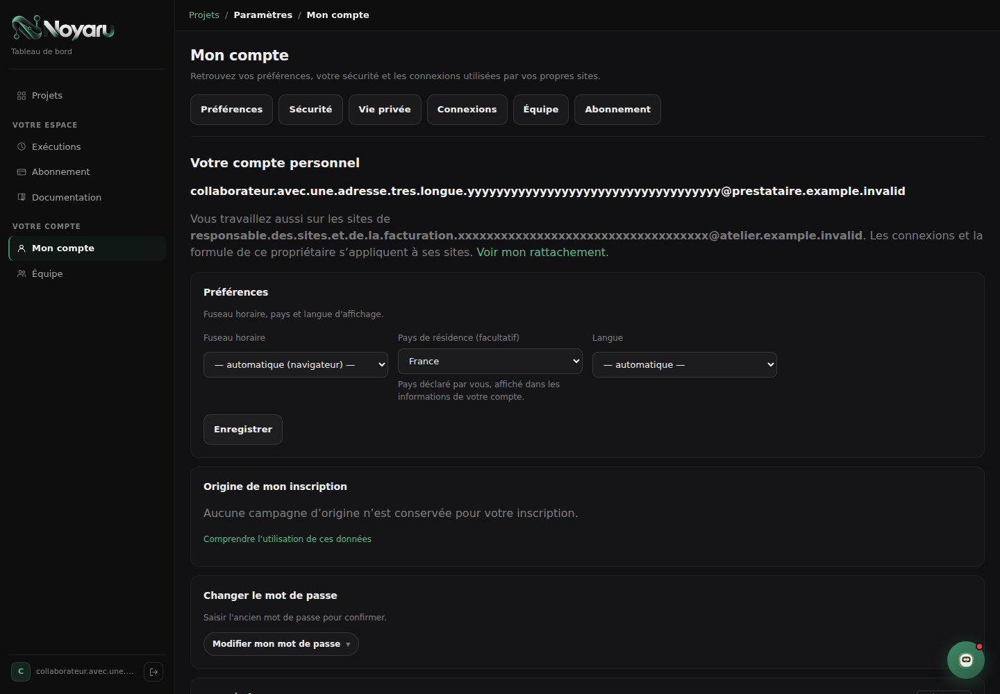
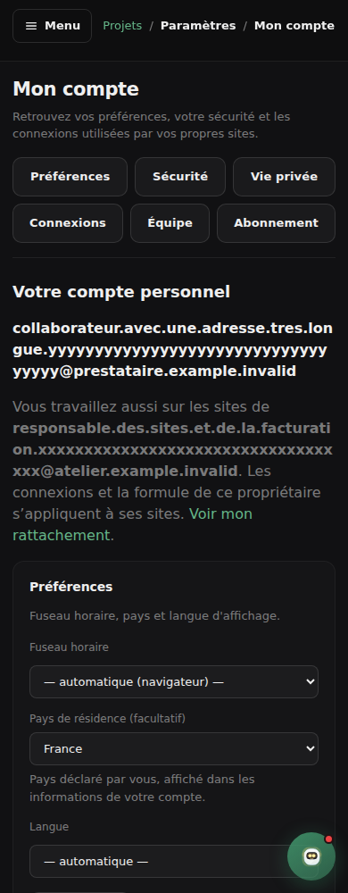
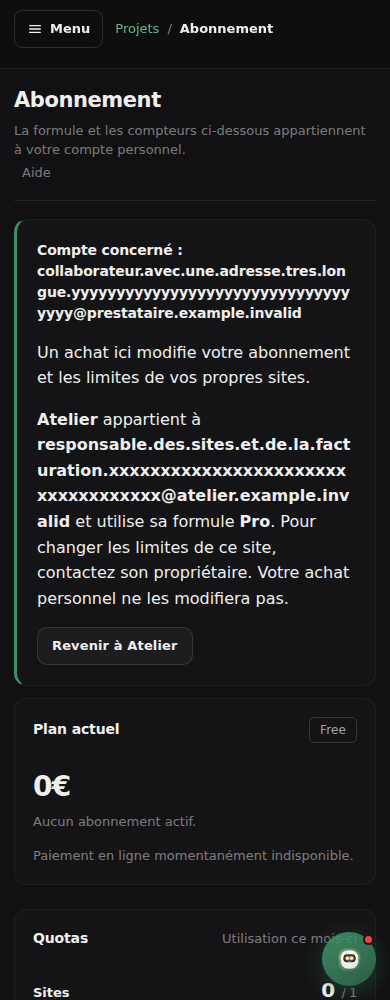
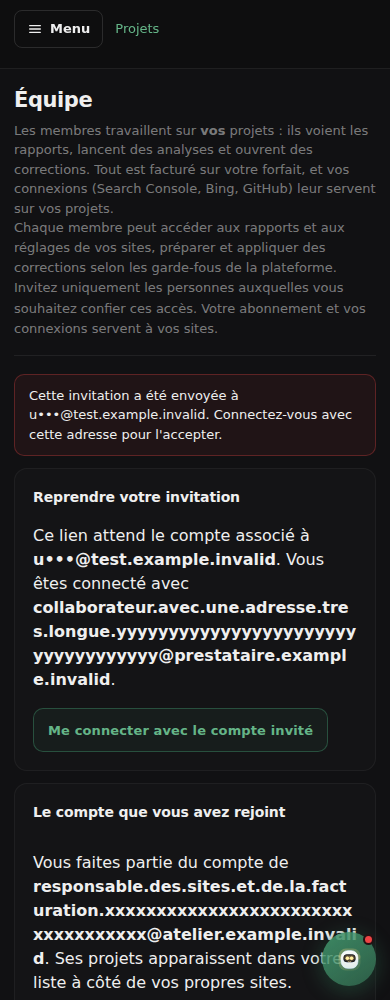
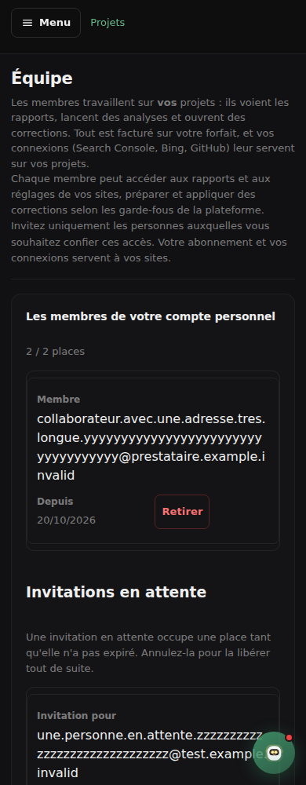
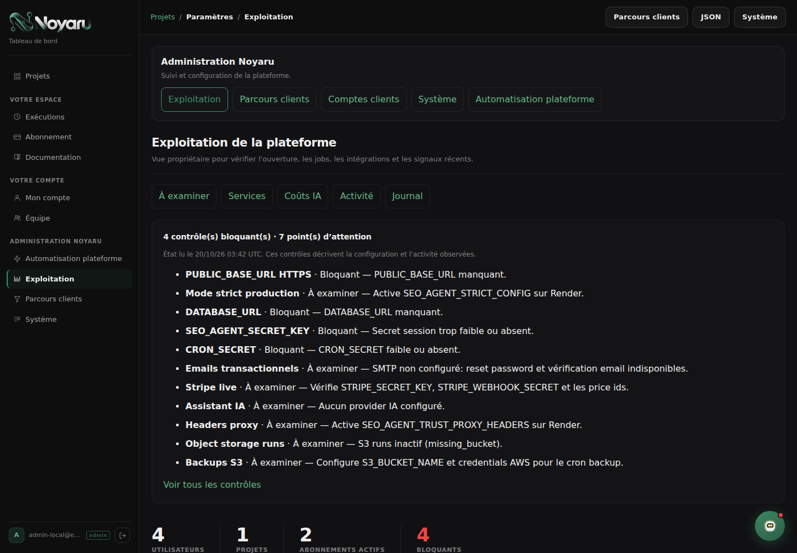
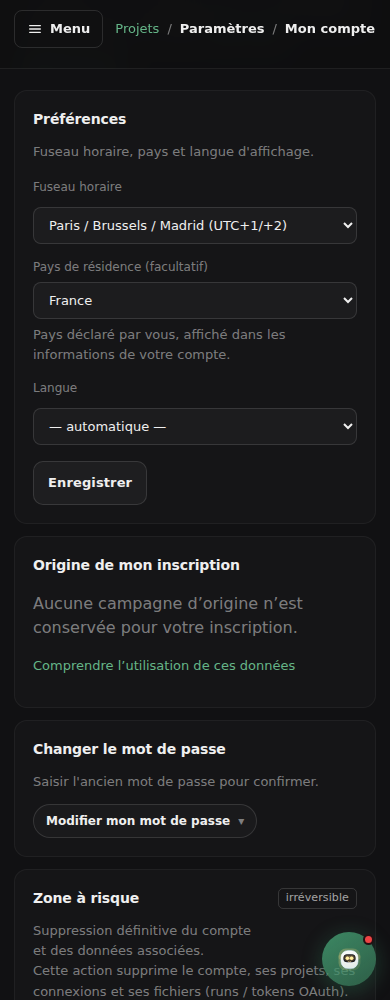

# Lot 6 — Compte, équipe, abonnement et administration

Base examinée : `main` après fusion de la PR #27, `ffc9ff4`. Bilan du 20 octobre 2026, établi avant les modifications de ce lot.

## Bilan écran par écran

C = code de la version courante ; L antérieur = navigateur local lors de l’audit initial. Tous les écrans de compte et d’administration exigent une session ; l’administration exige en plus les droits existants. Les tests locaux utilisent des comptes fictifs.

| Écran | Preuve initiale | Problème et conséquence | Proposition | Priorité |
| --- | --- | --- | --- | --- |
| Mon compte `/settings/accounts` | C, L antérieur | Préférences après quatre connexions : réglage personnel difficile à retrouver. | Préférences en premier, identité du compte, raccourcis Sécurité / Vie privée / Connexions ; ancres existantes conservées. | P1 |
| Listes GitHub, Bing, Netlify et fenêtres d’aide | C | Chargement possible sans connexion ; erreur de session traitée comme JSON invalide. | Disponibilité selon connexion réelle, chargement unique, état persistant et lien de reconnexion ; aide nommée. | P1 |
| Succès de sauvegarde | C | Disparition automatique après cinq secondes. | Message persistant, fermable explicitement au clavier. | P1 |
| Abonnement `/billing`, annulation, changement différé, factures | C, L antérieur sans Stripe | Quotas personnels visibles depuis un projet partagé : achat possible sur le mauvais compte. | Compte propriétaire indiqué avant les tarifs, formule du site distincte de la formule personnelle, retour au site. Calculs et mécanismes Stripe conservés. | P1 |
| Équipe `/settings/team` : sans places, libre, pleine, membre rattaché | C, L antérieur | Tutoiement, emails longs et champ sans label ; droits peu contextualisés. | Compte personnel et compte rejoint séparés ; droits et payeur expliqués ; invitation nommée, confirmations existantes. | P1 |
| Invitation `/team/accept` : valide, erronée, expirée, utilisée, mauvais compte | C | Refus après changement de session sans moyen de reprendre le lien ; adresse complète dans le message d’erreur. | Adresse masquée, reprise avec le bon compte en conservant l’invitation ; expiration explicite. Ne pas modifier l’acceptation autorisée existante. | P1 |
| Erreurs 401/403/404/429/500/503 | C, L antérieur 403/404 | Promesse inconditionnelle de notification ; retour JavaScript sans destination certaine. | Explication honnête par état, sortie stable vers site accessible / sites / connexion, aide ; aucune répétition automatique d’une écriture. | P1 |
| Automatisation globale `/automation` | C, L antérieur | Même nom que le réglage d’un projet. | Administration identifiée, titre et portée plateforme. | P2 |
| Exploitation `/settings/operations` | C, L antérieur | Incidents enfouis après les coûts ; mois sans nom. | Résumé des contrôles non satisfaits, navigation par section, mois nommé et date de lecture. | P2 |
| Système `/settings/system` | C, L antérieur | Configuration interne proche des réglages clients. | Bandeau commun d’administration et navigation par section ; masquage et confirmations préservés. | P1 |
| Parcours clients `/settings/activation` | C, L antérieur | Effectif actuel et cohortes difficiles à distinguer dans la navigation. | Accès Aujourd’hui / Premiers résultats / Campagnes, mêmes calculs et inconnus. | P2 |
| Comptes clients et fiche | C, L antérieur | La fiche perd la liste filtrée. | Conserver les filtres et la page dans le lien aller-retour ; résumé des critères ; préserver exports et en-têtes privés. | P2 |

## Parcours cible et règles communes

Mon compte → préférences / sécurité / vie privée ; connexions du compte → choix du site → réglages du site. Un collaborateur distingue ses propres sites des sites partagés. Une limite de formule renvoie à l’abonnement avec le site en contexte, puis revient à celui-ci ; l’achat reste celui du compte connecté.

Invitation → connexion → contrôle de l’adresse et des places → accès aux sites du propriétaire. En cas de mauvais compte, déconnexion explicite puis connexion avec retour au même lien ; une invitation expirée demande un nouveau lien. Aucun email réel n’est envoyé pendant la recette.

Fond et composants Noyaru conservés ; navigation de section commune, texte lisible et vouvoiement ; coordonnées longues repliées ; contrôles tactiles de 44 px ; tableaux défilants nommés ; retour visuel persistant après sauvegarde. L’administration annonce sa portée et reste soumise aux gardes serveur.

## Livraison et vérification

Livré : préférences personnelles avant les connexions, repères compte/site, invitations avec reprise du bon compte, confirmations persistantes et fermables, facturation contextualisée, erreurs honnêtes et administration repérable. Les anciens liens d’ancre et les noms de modes contractuels restent valables.

La page Abonnement continue de présenter et de modifier **uniquement le compte connecté**. Le contexte du site est résolu par les gardes serveur existantes avant tout appel Stripe ; un site inaccessible retourne 404. Le lien de navigation conserve les filtres de consultation et écarte les identifiants de travaux reçus dans l’URL. Le calcul des formules, des quotas, des places et les opérations Stripe ne changent pas.

Les invitations gardent leur acceptation existante : adresse, expiration, usage unique, appartenance et places sont revérifiés. Le mauvais compte voit une adresse masquée et une déconnexion explicite avec retour au lien ; une invitation expirée ou utilisée ne propose pas ce changement de compte. Les pages contenant ce contexte restent sans cache et sans référent.

| Vérification | Preuve réellement recueillie |
| --- | --- |
| Compte, préférences, sécurité, suppression et aide des connexions | Navigateur local : hiérarchie, fenêtres ouvertes/fermées au clavier, API de dépôts vide/indisponible/401 simulée. Sauvegarde réelle des préférences dans la base locale ; confirmation encore présente après 5,5 s, puis fermée au clavier. Aucun mot de passe ni compte supprimé. |
| Équipe | Navigateur local : membre Free, propriétaire avec places, propriétaire complet, adresses longues et cartes mobiles. Invitation réelle par email non exécutée. |
| Invitations | Navigateur : mauvais compte, expiration, déconnexion et retour du lien à la connexion. Tests serveur : acceptation par la bonne adresse, usage unique, lien expiré/utilisé/invalide, absence d’adhésion après refus et garde CSRF. |
| Abonnement | Navigateur : compte personnel, site partagé, propriétaire, paiement indisponible, abonnement actif, changement différé, résiliation et factures fictives. Tests serveur existants de paiement et nouveaux tests de périmètre. Aucun paiement ni portail Stripe réel ouvert. |
| Administration | Les six écrans et la fiche filtrée affichés aux quatre largeurs. Aller-retour de la liste vers la fiche en conservant formule, recherche, indicateur, situation et page. Exports et en-têtes privés préservés ; aucun réglage système enregistré. |
| Erreurs | Pages 401/403/404/429/500/503 rendues par les vrais gestionnaires à partir d’exceptions HTTP de test. Pas d’incident de production provoqué. Tests de la sortie vers un site autorisé et du repli pour un site inaccessible. |
| Non-régression | 12 affichages des corrections déjà livrées : confirmation, lot WordPress mixte et proposition GitHub en attente de publication. Transports simulés. |
| Accès public | Tarifs aux quatre largeurs, puis les deux pages d’aide mises à jour aux quatre largeurs, sans cookie de session. |

**147 affichages Chromium locaux** : 118 cas du parcours, 12 régressions, 9 affichages complémentaires (dont 4 tarifs publics) et 8 pages d’aide. Largeurs : 1 440, 768, 390 et 360 px. Aucun débordement horizontal ni erreur JavaScript dans ces recettes. Les styles sont entièrement chargés avant la mesure des liens de navigation.

**683 mesures de contraste** sur les nouveaux repères et explications, composées avec les fonds calculés : minimum **4,6:1**. Cela couvre les éléments échantillonnés ; une recette avec lecteur d’écran humain reste à faire.

**118 tests ciblés réussis** : compte, équipe, facturation, fiches privées, première analyse, rendu général et deux témoins de crawl dans Chromium. Compilation Python, Ruff F/E9, 77 templates Jinja et Bandit medium/high valides. Le résultat de la suite complète sur le commit publié est reporté dans la PR. Le premier passage local a signalé les deux attentes d’intitulés à actualiser, la copie d’un identifiant de travail dans le retour de navigation et les bibliothèques Chromium absentes de cette commande ; ces cas passent dans la recette ciblée finale.

Les connexions fournisseurs et la production authentifiée restent à vérifier avec de vrais comptes. Les formulaires de clés et de paiement n’ont pas été soumis dans le navigateur. Les méthodes d’évaluation de la progression client, les données historiques inconnues et les calculs de consommation restent ceux du serveur.

## Captures et traces

[Résultats du parcours](ux-account-team/evidence.json), [régression des corrections](ux-account-team/correction-regression.json), [contrastes](ux-account-team/contrast-evidence.json), [captures complémentaires et tarifs](ux-account-team/capture-evidence.json), [aide publique](ux-account-team/docs-evidence.json).

