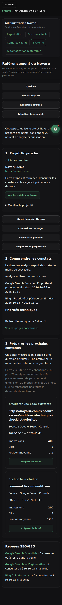
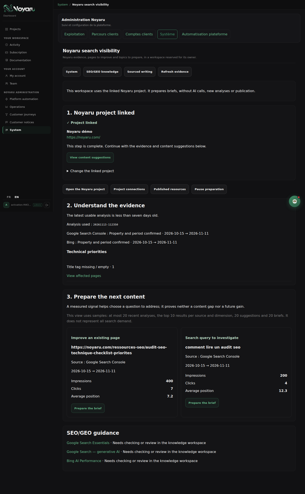

# Afficher clairement le projet Noyaru déjà lié

14 novembre 2026, base `main 80e5cba`.

## Constat et comportement

La capture opérateur de Référencement de Noyaru montre une liaison réussie et les
actions du projet. Pourtant, « Choisir le projet Noyaru », sa confirmation et le
bouton « Lier ce projet » restent affichés comme une étape inachevée. Le propriétaire
ne sait pas si la liaison a été enregistrée. Priorité P1 dans le parcours du blog.

La carte affiche désormais le projet lié et une confirmation textuelle persistante,
puis « Voir les sujets à préparer », qui mène à la section 3. Le formulaire de
modification volontaire est conservé dans un volet fermé, avec sa confirmation
et un rappel sur les anciens briefs. L'état initial garde le formulaire ouvert.
La préparation en pause reste signalée indépendamment de la liaison.

Le service de liaison, les droits et le contenu des formulaires ne changent pas.
Aucun appel IA, analyse, connexion de compte ou publication n'est ajouté. Les textes
FR/EN sont limités au module propre de cette page ; aucun catalogue partagé modifié.

## Vérifications

- 47 tests existants réussis : liaison, droits propriétaire, cible exacte, périmètre
  des preuves, invalidation des anciens briefs, pause, formulaires et migration.
- 44 observations Chromium locales FR/EN : 1440, 1024, 768, 390 et 360 px ; états
  non lié, lié, préparation suspendue et nom très long, puis quatre parcours natifs
  de liaison et d'actualisation (ordinateur/mobile, FR/EN).
- Le formulaire est visible avant la première liaison et replié après elle, y
  compris après actualisation. Sa confirmation reste obligatoire. Le volet se
  déplie, le lien vers les sujets conserve le titre sous le bandeau fixe, aucune
  largeur ne déborde, aucune erreur JavaScript ni requête externe observée.
- Ruff F/E9 et `git diff --check` réussis. CI complète suivie dans la PR.

La recette utilise une nouvelle base SQLite, des comptes fictifs et les vraies
routes/gabarits sur un serveur local ; tous les appels externes sont bloqués.
Le script `browser_smoke.py`, les observations `browser.json` et les deux captures
fictives accompagnent ce bilan. Aucun accès administrateur de production utilisé.
La capture de Tony prouve le problème initial ; la recette privée après déploiement
reste une observation distincte à effectuer par l'opérateur.

